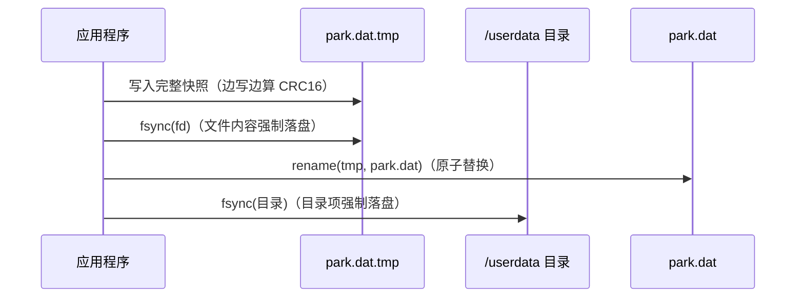
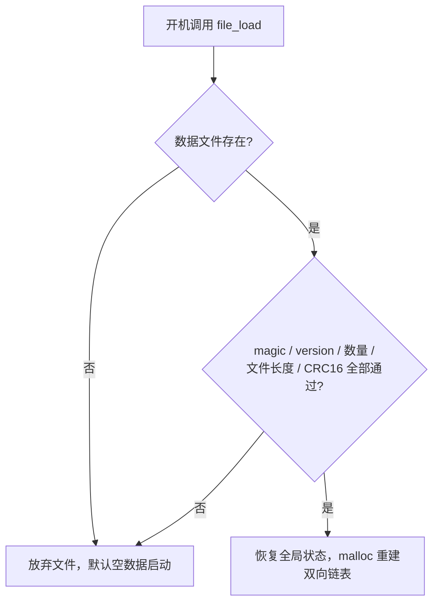

# 智能停车场管理系统 / Smart Parking System

基于 ARM Linux 开发板的嵌入式智能停车场管理系统：LVGL 触摸屏 GUI、TCP 多线程远程监控、**断电数据保护（原子写 + CRC16 校验 + 开机恢复）**。

An embedded smart parking system on an ARM Linux board, featuring an LVGL touchscreen GUI, a multi-threaded TCP server for remote monitoring, and **power-loss data protection (atomic snapshot + CRC16 + recovery on boot)**.

---

## 一、项目简介 / Introduction

本项目运行在 RK3568 开发板上，通过触摸屏完成车辆入场、出场、计费、车位管理与营收统计，同时通过 TCP 网络接口对外提供实时查询。为应对嵌入式设备意外断电的场景，系统设计了一套完整的纯软件持久化方案：每次状态变更后将全量快照以"临时文件 + 原子替换"方式写入 eMMC 持久分区，并通过 CRC16 校验保证数据损坏可被识别，开机时自动恢复断电前的车辆与营收数据。

The project runs on an RK3568 development board. It provides entry/exit, billing, parking-space management and revenue statistics on a touchscreen, plus a TCP API for remote queries. To survive sudden power loss, it writes a full snapshot to the persistent eMMC partition using a temp-file + atomic-rename scheme, protects the file with CRC16, and reconstructs the full state on every boot.

## 二、功能特性 / Features

- **车辆入场**：触摸键盘录入车牌、自动分配车位（1～8 号）、记录入场时间
- **车辆出场**：按实际停车时长自动计费
  - 15 分钟内免费
  - 首小时 5 元，之后每小时 1 元（不足 1 小时按 1 小时计）
  - 每日封顶 28 元
- **车位管理**：8 个车位，双向链表维护在场车辆，按车位号有序
- **营收统计**：今日收入、累计订单数，跨天自动清零
- **系统时钟**：软件时钟，支持手动设置时间，界面实时走时
- **TCP 远程监控**：8888 端口，每个连接一个线程，自定义文本协议
  - `STATUS`：查询总车位 / 已用 / 空闲及每辆车的车位、车牌、入场时间
  - `REPORT`：查询今日收入、在场车辆数、累计订单数
  - `FIND 车牌`：按车牌查车
  - `QUIT`：断开连接
  - 每条回复以 `###END###` 结尾作为结束标记，解决 TCP 粘包/拆包
- **断电保护**：见下方"六、断电保护设计"

## 三、硬件与软件平台 / Platform

| 项目 | 说明 |
| --- | --- |
| 开发板 | RK3568 开发板（核心板 + 底板 + 触摸屏） |
| SoC | Rockchip RK3568，四核 ARM Cortex-A55（64 位，最高 2.0 GHz），Mali-G52 GPU |
| 存储 | eMMC（用户数据持久分区 `/userdata`） |
| 显示 | LCD 触摸屏，Linux framebuffer `/dev/fb0` |
| 触摸 | evdev 输入设备 `/dev/input/event6` |
| 系统 | 嵌入式 Linux（Buildroot，root 用户） |
| GUI 库 | LVGL 9.0.0（DRM/framebuffer 后端） |
| 语言/标准 | C99，POSIX 线程 |
| 交叉编译 | CMake + `arm-linux-gcc`（`/usr/local/arm-linux`） |

## 四、目录结构 / Source Layout

```
.
├── main.c                       # LVGL 各界面（主界面/入场/出场/车位/报表/设置）、系统时钟、开机入口
├── carnum.c / carnum.h          # 核心：双向链表车位管理、计费、互斥锁、断电保护（保存/加载）
├── car_serve.c / car_serve.h    # TCP 服务器：8888 端口，线程池式 accept + 每客户端一线程
├── car_client.c                 # TCP 客户端测试程序
├── income.c / income.h          # 收入统计接口
├── color_cb.c / color_cb.h      # 颜色辅助
├── lv_conf.h                    # LVGL 配置
├── mouse_cursor_icon.c          # 鼠标光标资源
├── lv_project_carpark_font_50.h # 中文字体
└── CMakeLists.txt               # 交叉编译与构建配置
```

## 五、软件架构 / Architecture

- **UI 线程**：LVGL 主循环，负责所有界面渲染与触摸事件，软件时钟每秒 tick；
- **网络线程**：主线程 accept 后为每个客户端创建独立线程，与 UI 共享车位数据，通过互斥锁保护；
- **数据模型**：在场车辆以双向链表存储，每个节点含车位号、车牌（UTF-8，最长 15 字符）、入场时间；
- **持久化**：入场、出场、手动设置时间成功后，立即把全量状态快照写入数据文件。

## 六、断电保护设计 / Power-Fail Protection（亮点）

### 1. 原子写（atomic replacement）

保存时从不直接覆盖正式文件，而是走四步：



`rename` 在同一文件系统内是原子操作：断电时正式文件要么完整是旧版本、要么完整是新版本，绝不会出现写了一半的损坏文件。

### 2. 二进制文件格式（固定字节布局，无结构体 padding）

```
┌──────────────────── 文件头 52 字节 ────────────────────┐
│ 偏移  长度  字段                    类型               │
│  0    4    magic "PARK"            char[4]            │
│  4    2    version                 uint16 (=1)        │
│  6    2    car_count               uint16 (0~8)       │
│  8    4    今日收入（单位：分）      int32              │
│ 12    4    累计订单数               int32              │
│ 16    12   收入日期 y/mo/d          int32[3]           │
│ 28    24   系统时钟 y/mo/d/h/mi/s   int32[6]           │
├──────────────── 每条记录 40 字节 ──────────────────────┤
│  0    4    车位号                  int32              │
│  4    16   车牌（UTF-8，0 填充）    char[16]           │
│ 20    20   入场时间 y/mo/d/h/mi    int32[5]           │
├───────────────────────────────────────────────────────┤
│ 最后 2 字节：CRC16（覆盖前面所有字节）                 │
└───────────────────────────────────────────────────────┘
```

文件大小恒为 `52 + 40 × car_count + 2`，多一字节、少一字节都判为损坏。

- CRC16 参数：CRC16-CCITT-FALSE，多项式 `0x1021`，初值 `0xFFFF`，不反射、不异或输出（标准校验串 `"123456789"` → `0x29B1`）；
- 金额以"分"存储、时间以定宽整数存储，避免浮点误差与跨平台字节长度差异；
- 数据文件路径由宏 `DATA_FILE` / `TMP_FILE` 配置，部署时指向 eMMC 持久分区（本板为 `/userdata`），**两个文件必须在同一分区** rename 才保证原子性。

### 3. 开机恢复（三道校验）



- 数据先全部读到临时数组，**所有校验通过后**才修改内存状态并重建链表，避免"恢复一半"；
- 任何一项校验失败（文件被截断、多余字节、CRC 不匹配）都安全降级为初始状态，程序不会崩溃。

### 4. 实测

板上实测：写入 2 辆车后生成 134 字节（`52 + 2×40 + 2`）数据文件，`hexdump -C` 逐字段核对正确；断电重启后车辆、时钟、收入全部恢复。

## 七、编译与运行 / Build & Run

依赖：交叉编译工具链 `arm-linux-gcc`，以及与项目同目录的 **LVGL 9.0** 源码（`CMakeLists.txt` 中 `add_subdirectory(lvgl)`，仓库不含第三方库）。

```bash
# 1. 在 Linux 构建环境中进入项目目录
cd <project>

# 2. 生成并编译
mkdir -p build && cd build
cmake ..
make
# 可执行文件输出到 ../bin/main
```

部署到开发板（串口/网络拷贝后，以 root 运行）：

```bash
./main
# 程序启动后：
#   - 触摸屏显示停车系统界面
#   - TCP 监听 0.0.0.0:8888
```

TCP 测试（开发板上可用 telnet/nc，或运行 car_client）：

```
STATUS
REPORT
FIND 湘A12345
QUIT
```

## 八、运行截图 / Screenshots

> 待补充：触摸屏主界面、入场/出场界面、报表界面、TCP 客户端查询输出、断电恢复实测。

## 九、技术要点总结 / Highlights

- POSIX `write` 短写处理（循环写满）、`fsync` 文件与目录、`rename` 原子替换；
- CRC16-CCITT 软件实现与全文件校验；
- 自定义定长二进制存储格式，跨平台定宽整数（`int32_t` / `uint16_t`）；
- 多线程共享数据的互斥锁保护；
- TCP 多线程服务器与应用层结束标记解决粘包/拆包；
- 双向链表的有序插入、删除与开机重建。

## 十、License

本项目代码采用 MIT License；LVGL 为其各自作者的开源项目（MIT License）。
